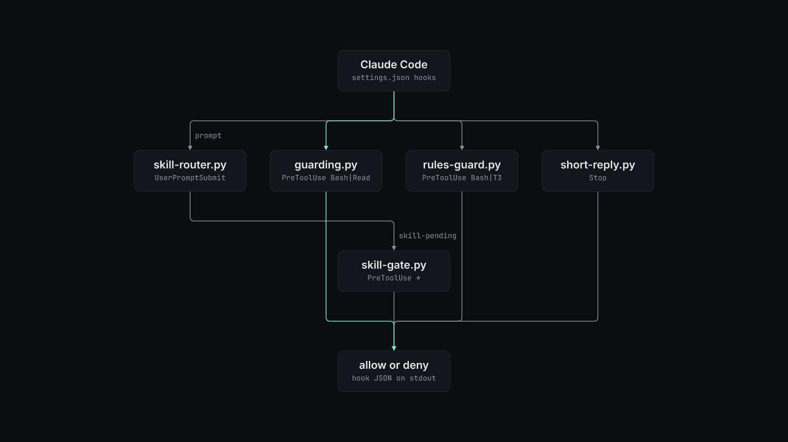

# claude-code-guardrails

Hooks that stop Claude Code from doing the things you keep telling it not to.

Claude Code hooks that refuse risky tool calls, hold work until the right skills are loaded, and cap the length of replies a person reads.


## Why

An instruction in `CLAUDE.md` is a request to the model. The model can forget it, and it forgets most often late in a long session. A hook is a program that Claude Code runs before or after each step, so its rule holds every time. These hooks turn standing rules into checks: no push to `main`, no credential file in the model's context, no SSH to a production host, no merge that is not bound to the reviewed head commit, no reply over 6 lines or 700 characters to the operator, and no edit before the skills that match the prompt are loaded. Each refusal tells the agent what to do instead, so it can retry the right way in the same turn.

## Install

Requirements:

- Claude Code with hooks (tested with 2.1.316).
- Python 3.11 or later (tested with 3.12.3). The hooks use only the standard library.
- Bash and GNU `date` for `hooks/now.sh`.
- `gh`, signed in, for the merge gate in `rules-guard.py` and for `verdict check`.
- `ssh` for the production-host check in `guarding.py`. It runs `ssh -G`, which reads configuration and never connects.
- For the skill router, one judge: an `OPENROUTER_API_KEY` for Jev, or the Haiku daemon in `hooks/skill-judge-daemon.py`.
- `jq` to run the examples in this README.

1. Put the repository at `~/oss/claude-code-guardrails`. Every hook command in `settings.example.json` uses that path. To use another path, edit the paths in your copy of the hooks block.

   ```bash
   git clone <this-repo-url> ~/oss/claude-code-guardrails
   cd ~/oss/claude-code-guardrails
   ```

2. Add the hooks to `~/.claude/settings.json`. If that file has no `hooks` key yet, this command adds the whole block from `settings.example.json`:

   ```bash
   jq -s '.[0] + {hooks: .[1].hooks}' ~/.claude/settings.json settings.example.json > /tmp/settings.json \
     && mv /tmp/settings.json ~/.claude/settings.json
   ```

   If you already have hooks, copy the entries from `settings.example.json` into your arrays by hand. `jq`'s `*` merge replaces arrays, so it would drop your existing hooks.

3. Write your policy. The hooks read `guardrails.example.json` from the repository root unless `GUARDRAILS_CONFIG` names another file. Copy it, edit the copy, and export the path in the shell that starts Claude Code:

   ```bash
   mkdir -p ~/.config/claude-code-guardrails
   cp guardrails.example.json ~/.config/claude-code-guardrails/guardrails.json
   export GUARDRAILS_CONFIG=~/.config/claude-code-guardrails/guardrails.json
   ```

   The file must be complete. The hooks do not merge it with the example.

4. Start a new Claude Code session. Hooks load at session start.

## Quick start

You can run every hook without Claude Code. A hook reads one JSON event on stdin and writes its decision to stdout. `docs/media/calls/` holds four sample tool calls.

```console
$ python3 hooks/guarding.py < docs/media/calls/read-credentials.json | jq -r '.[][]'
PreToolUse
deny
Credentials never enter model context. Use the owning tool's authenticated interface.
```

Run all four samples through both PreToolUse guards. A call with no output is allowed.

```console
$ for f in docs/media/calls/*.json; do
  printf '%s: ' "$(basename "$f" .json)"
  { python3 hooks/rules-guard.py < "$f"; python3 -S hooks/guarding.py < "$f"; } | jq -r '.hookSpecificOutput.permissionDecisionReason' | grep . || echo allow
done
push-branch: allow
push-main: No direct push to main/master: push a feature branch, open a PR, gate it, then gh pr merge.
read-credentials: Credentials never enter model context. Use the owning tool's authenticated interface.
ssh-production: Production server refused by resolved SSH configuration. Use an allowed CI host.
```

Run the test suites. Neither one writes to live state.

```console
$ python3 hooks/rules-guard-test.py
145/145 pass
$ python3 hooks/hooktest.py
....................................
----------------------------------------------------------------------
Ran 36 tests in 83.452s

OK
```

## How it works



Claude Code runs each hook as a command, passes the event as JSON on stdin, and reads the decision from stdout. A PreToolUse hook denies a call by printing `hookSpecificOutput` with `permissionDecision: "deny"` and a reason. The agent sees the reason and can retry. `hooks/policy.py` loads the JSON policy once per hook process.

| Hook | Event | What it does |
| --- | --- | --- |
| `hooks/guarding.py` | PreToolUse, `Bash` and `Read` | Refuses reads of the configured credential stores, by the Read tool or by shell readers such as `cat`, `sed` and `cp`. Refuses `ssh`, `scp`, `rsync` and `sftp` to a protected host, after it resolves the target with `ssh -G`. Under `shared_checkout`, refuses `git commit` without explicit paths and refuses `-a`. It parses the command and never runs it. |
| `hooks/rules-guard.py` | PreToolUse, `Bash` and T3 Code tools | Refuses `git push` without a named remote and branch, a push to a protected branch, and `--all` or `--mirror`. Accepts one merge form only, `gh pr merge <n> -R <owner/repo> --squash --match-head-commit <sha>`, and only when `<sha>` is the PR's current head and the PR is not behind its base. Refuses ref and contents writes through the GitHub API. In T3 Code, checks the model, effort and service tier of each `delegate_task` and refuses thread-opening tools unless the operator marker file is fresh. |
| `hooks/skill-router.py` | UserPromptSubmit, async | Asks a judge which installed skills match the prompt, then tells the agent to load them. It writes the list to `~/.claude/state/skill-pending/<session>`. |
| `hooks/skill-gate.py` | PreToolUse, all tools | Records each `Skill` call. Denies the first edit, command or delegation while router-picked skills are still unloaded, then clears the hold, so an agent that judges a skill off-subject is held once. |
| `hooks/short-reply.py` | UserPromptSubmit (`remind`) and Stop (`check`) | Adds the reply rule to each prompt and blocks a final reply over `max_lines` or `max_chars`. It stands down when the reader is an agent, which means a T3 Code child ("Act as the ... sub-agent"), a headless SDK run, or a prompt with a `READER: agent` line. |
| `hooks/now.sh` | UserPromptSubmit | Prints the date and time in `LOCAL_TZ`, UTC and US East, plus the part of day. |

The SessionStart entry in `settings.example.json` deletes `~/.claude/state/skill-loaded/<session>` after `/compact` or `/clear`, because the loaded skills leave the context then.

The skill router picks a judge with `SKILL_JUDGE`. The default, `jev`, sends one request to OpenRouter's decisions endpoint with one yes or no question per skill and keeps skills at or above `SKILL_JEV_T`. If Jev fails, the router asks the Haiku daemon over a Unix socket. Start the daemon yourself with `python3 hooks/skill-judge-daemon.py`. It keeps warm `claude -p` processes, or calls an Anthropic or OpenAI compatible API when `SKILL_JUDGE_PROVIDER` says so. When every judge is down, the router says so to the agent instead of guessing. `hooks/skill-router-eval.py` scores the router against labelled prompts and your local skill catalog.

Failure modes differ on purpose. `rules-guard.py` fails closed when an error happens during a gated action (a merge, a push, a delegation) and fails open otherwise. The `settings.example.json` entry also refuses the call if the script crashes. `guarding.py`, `skill-router.py`, `skill-gate.py` and `short-reply.py` fail open, so a bug in them never blocks work.

### Verdict ledger

`verdict` records one row per reviewed head commit in a TSV ledger. On repositories that match `status_repositories`, `add` also posts a `gate/cross-family` commit status. `rules-guard.py` does not read the ledger.

```console
$ python3 verdict add example/project 12 9575b9cac7b62bb0f2945ff793da025d6e4de99f claude-opus-5-5 gpt-6.1-sol APPROVE review.md
$ python3 verdict list
2026-11-03T18:52:46Z example/project#12 9575b9ca claude->gpt APPROVE review.md
```

`verdict check <owner/repo> <pr>` exits 0 only when the latest row for the PR's current head is an `APPROVE` from a reviewer in a different model family than the author.

## Configuration

The policy file has five sections. Every key is required, because the hooks read them without defaults. The default column shows the value in `guardrails.example.json`.

| Option | Default | What it does |
| --- | --- | --- |
| `rules.allowed_models` | `claude-opus-5-5`, `gpt-6.1-sol`, `gpt-6-luna`, `gpt-6-astra` | Models a `delegate_task` target may use. |
| `rules.bad_effort` | `xhigh`, `max`, `ultra`, `ultracode`, `ultrathink` | Effort values refused for every model. |
| `rules.codex_efforts` | `low`, `medium` | Effort values allowed for models not in `claude_models`. |
| `rules.claude_models` | `claude-opus-5-5` | Models exempt from `codex_efforts` and the service tier check. |
| `rules.codex_service_tiers` | `priority`, `fast` | Allowed `serviceTier` for other models. |
| `rules.default_service_tier` | `priority` | Tier assumed when the target options have no `serviceTier`. |
| `rules.thread_tools` | `t3_thread_launch`, `create_threads`, `t3_thread_fork`, `t3_project_create` | T3 Code tools that open threads or projects. |
| `rules.thread_marker` | `~/.claude/state/operator-asked-thread` | Touch this file to allow a thread tool. |
| `rules.thread_marker_seconds` | `900` | How long the marker stays fresh. |
| `rules.protected_branches` | `main`, `master`, `HEAD` | Branches `git push` may not target. |
| `reply.max_lines` | `6` | Most non-empty lines in a reply to the operator. |
| `reply.max_chars` | `700` | Most characters in a reply to the operator. |
| `reply.reminder` | the reply rule | Text added to each prompt. Accepts `{max_lines}` and `{max_chars}`. |
| `reply.blocked` | the block message | Reason given when a reply is too long. Also accepts `{lines}` and `{chars}`. |
| `guarding.shared_checkout` | `~/agency` | Checkout where commits must name their paths. |
| `guarding.credential_stores` | `.codex/auth.json`, `.codex_work/auth.json`, `.claude/.credentials.json`, `.config/gh/hosts.yml`, `.pi/agent/auth.json` | Files under `~` that no read may touch. |
| `guarding.protected_hosts` | `production-host` | SSH host names and resolved `HostName` values to refuse. |
| `guarding.protected_proxy_pattern` | `\bboat proxy project-b\b` | Regular expression matched against the resolved `ProxyCommand`. |
| `guarding.credential_reason` | message | Reason for a refused credential read. |
| `guarding.commit_reason` | message | Reason for a refused commit. |
| `guarding.host_reason` | message | Reason for a refused SSH target. |
| `router.never_route` | `docs`, `humanizer`, `skill-creator` | Skill names the router never suggests. |
| `verdict.ledger` | `~/.claude/verdicts.tsv` | Ledger file for `verdict`. |
| `verdict.status_repositories` | empty | `owner/repo` prefixes where `verdict add` posts a commit status. |
| `verdict.github_user` | empty | `gh` account whose token posts the status. Empty uses the current login. |
| `verdict.github_users_by_prefix` | empty | Map of repository prefix to `gh` account, checked before `github_user`. |

Paths accept `~` and environment variables.

Environment variables:

| Variable | Default | What it does |
| --- | --- | --- |
| `GUARDRAILS_CONFIG` | `guardrails.example.json` in the repository | Policy file for every hook and `verdict`. |
| `LOCAL_TZ` | `UTC` | Time zone for the local line of `now.sh`. |
| `OPENROUTER_API_KEY` | unset | Key for the Jev judge. Without it the router uses the Haiku daemon. |
| `SKILL_JUDGE` | `jev` | `jev`, `haiku`, or `union` (both judges, names combined). |
| `SKILL_JEV_MODEL` | `typesafe/jev-1.14-20261014` | Jev model on OpenRouter. |
| `SKILL_JEV_T` | `0.5` | Lowest Jev probability that routes a skill. |
| `SKILL_JUDGE_SOCK` | `~/.claude/state/skill-judge.sock` | Socket shared by the router and the daemon. |
| `SKILL_ROUTER_ASYNC` | set in `settings.example.json` | Emit the router's text as `additionalContext`, which an async hook needs. |
| `SKILL_JUDGE_PROVIDER` | `claude-cli` | Daemon backend: `claude-cli`, `anthropic` or `openai`. |
| `SKILL_JUDGE_MODEL` | `haiku` for `claude-cli` | Daemon model. API providers need one. |
| `SKILL_JUDGE_API_KEY` | unset | API key for the `anthropic` and `openai` providers. |
| `SKILL_JUDGE_BASE_URL` | the provider's public API | Base URL for a compatible API. |
| `SHORT_REPLY_FORCE` | unset | `1` makes `short-reply.py` treat the reader as the operator. The tests use it. |

The hooks keep their state in `~/.claude/state/`: `skill-pending/`, `skill-loaded/`, `skill-router-index.json`, `skill-router.log`, `skill-judge.sock` and `skill-judge.log`.

## Limits

- The shell checks read command text. They are not a sandbox, and a determined agent can write a command they do not parse. `rules-guard.py` refuses a push or merge command it cannot parse. `guarding.py` lets an unparseable command through unless its text names a credential store or a protected host.
- Tested on Linux only. `now.sh` uses GNU `date -d @<seconds>`, which the BSD `date` on macOS does not accept.
- The merge gate needs `gh` and the GitHub API. If it cannot read the PR head or compare it with the base, it refuses the merge.
- The `delegate_task`, thread and `acp-mcp-call` checks apply only in T3 Code. Elsewhere they never match.
- Without a reachable judge, the router adds a "judges are unreachable" note to every prompt of three or more words.
- Jev uses OpenRouter's alpha decisions endpoint, which can change.
- Hook commands in `settings.example.json` use absolute paths under `$HOME/oss/claude-code-guardrails`.
- `hooks/hooks.json` is a copy of `settings.example.json`.

## License

MIT. See [LICENSE](LICENSE).
