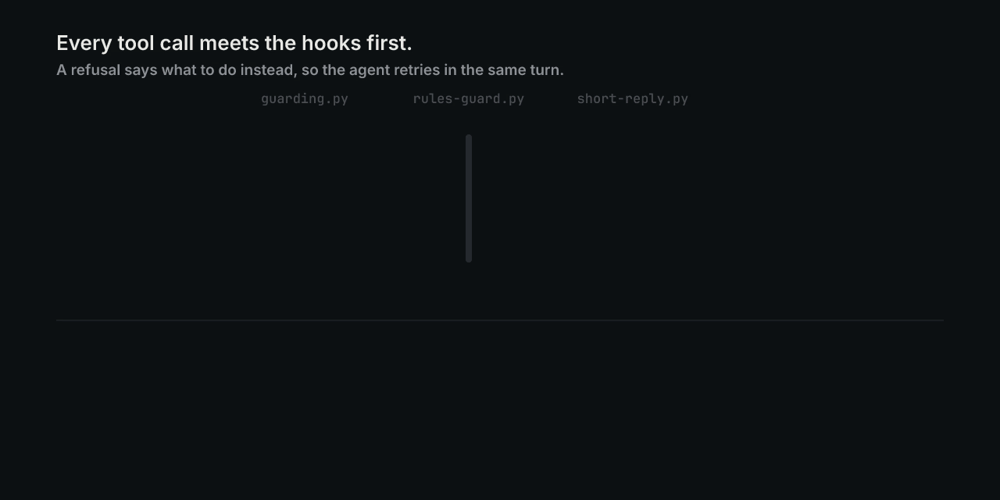

# claude-code-guardrails

Hooks that stop Claude Code from doing the things you keep telling it not to.

A rule in `CLAUDE.md` is a request the model forgets late in a long session. A hook runs before every tool call, so the rule holds: no push to `main`, no credential file in context, no SSH to production, no merge that is not bound to the reviewed head commit, no reply over 6 lines, no edit before the matching skills are loaded. Each refusal says what to do instead, so the agent retries the right way in the same turn.



## Install

Claude Code with hooks, Python 3.11+ (standard library only), `gh` signed in for the merge gate, and `jq`. The hook paths in `settings.example.json` assume `~/oss/claude-code-guardrails`.

```bash
git clone <this-repo-url> ~/oss/claude-code-guardrails && cd ~/oss/claude-code-guardrails
jq -s '.[0] + {hooks: .[1].hooks}' ~/.claude/settings.json settings.example.json > /tmp/s.json \
  && mv /tmp/s.json ~/.claude/settings.json      # only if you have no hooks yet; otherwise copy entries by hand
mkdir -p ~/.config/claude-code-guardrails
cp guardrails.example.json ~/.config/claude-code-guardrails/guardrails.json
export GUARDRAILS_CONFIG=~/.config/claude-code-guardrails/guardrails.json   # edit it: your hosts, branches, limits
```

Start a new Claude Code session; hooks load at session start. The skill router also needs a judge: `OPENROUTER_API_KEY` for Jev, or `python3 hooks/skill-judge-daemon.py` for Haiku.

## Use

Every hook reads one JSON event on stdin and prints its decision, so you can try them without Claude Code:

```console
$ for f in docs/media/calls/*.json; do
  printf '%s: ' "$(basename "$f" .json)"
  { python3 hooks/rules-guard.py < "$f"; python3 -S hooks/guarding.py < "$f"; } | jq -r '.hookSpecificOutput.permissionDecisionReason' | grep . || echo allow
done
push-branch: allow
push-main: No direct push to main/master: push a feature branch, open a PR, gate it, then gh pr merge.
read-credentials: Credentials never enter model context. Use the owning tool's authenticated interface.
ssh-production: Production server refused by resolved SSH configuration. Use an allowed CI host.
```

| Hook | Stops |
| --- | --- |
| `guarding.py` | Reads of credential files, SSH to protected hosts, `git commit -a` in a shared checkout |
| `rules-guard.py` | Pushes to protected branches, merges not pinned with `--match-head-commit`, GitHub API ref writes, T3 Code delegations to disallowed models or efforts |
| `skill-router.py` + `skill-gate.py` | The first edit while skills a judge matched to the prompt are still unloaded |
| `short-reply.py` | Final replies over 6 lines or 700 characters, unless the reader is an agent |
| `now.sh` | Nothing; it prints the real date and time into each prompt |

```bash
python3 hooks/rules-guard-test.py   # 145/145 pass
python3 hooks/hooktest.py           # 36 tests, about 80 s
python3 verdict list                # review ledger: one row per reviewed head commit
```

Every policy key and environment variable: [docs/configuration.md](docs/configuration.md). How each hook decides, which ones fail open or closed, and the verdict ledger: [docs/internals.md](docs/internals.md).

## Limits

- The shell checks read command text. They are not a sandbox, and a determined agent can write a command they do not parse. `rules-guard.py` refuses a push or merge command it cannot parse. `guarding.py` lets an unparseable command through unless its text names a credential store or a protected host.
- Tested on Linux only. `now.sh` uses GNU `date -d @<seconds>`, which the BSD `date` on macOS does not accept.
- The merge gate needs `gh` and the GitHub API. If it cannot read the PR head or compare it with the base, it refuses the merge.
- The `delegate_task`, thread and `acp-mcp-call` checks apply only in T3 Code. Elsewhere they never match.
- Without a reachable judge, the router adds a "judges are unreachable" note to every prompt of three or more words.
- Jev uses OpenRouter's alpha decisions endpoint, which can change.
- Hook commands in `settings.example.json` use absolute paths under `$HOME/oss/claude-code-guardrails`.
- `hooks/hooks.json` is a copy of `settings.example.json`.

## License

MIT
