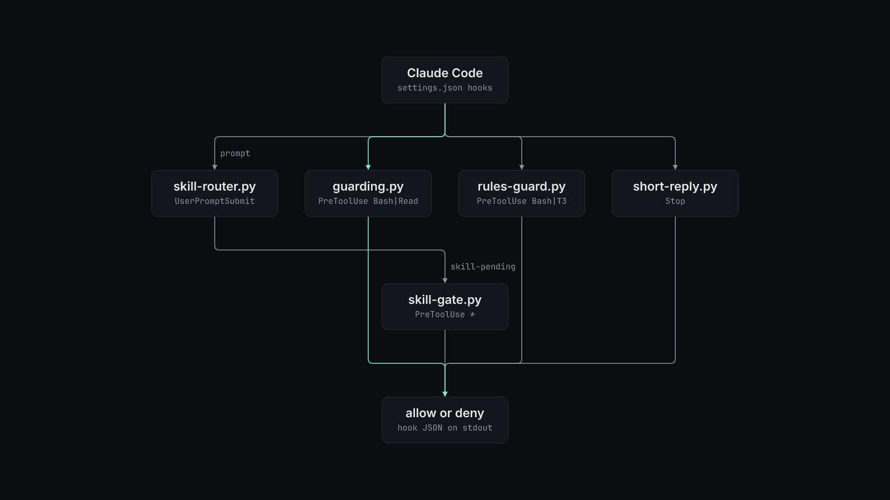

# How claude-code-guardrails works



Claude Code runs each hook as a command, passes the event as JSON on stdin, and reads the decision from stdout. A PreToolUse hook denies a call by printing `hookSpecificOutput` with `permissionDecision: "deny"` and a reason. The agent sees the reason and can retry. `hooks/policy.py` loads the JSON policy once per hook process.

| Hook | Event | What it does |
| --- | --- | --- |
| `hooks/guarding.py` | PreToolUse, `Bash` and `Read` | Refuses reads of the configured credential stores, by the Read tool or by shell readers such as `cat`, `sed` and `cp`. Refuses `ssh`, `scp`, `rsync` and `sftp` to a protected host, after it resolves the target with `ssh -G`. Under `shared_checkout`, refuses `git commit` without explicit paths and refuses `-a`. It parses the command and never runs it. |
| `hooks/rules-guard.py` | PreToolUse, `Bash` and T3 Code tools | Refuses `git push` without a named remote and branch, a push to a protected branch, and `--all` or `--mirror`. Accepts one merge form only, `gh pr merge <n> -R <owner/repo> --squash --match-head-commit <sha>`, and only when `<sha>` is the PR's current head and the PR is not behind its base. Refuses ref and contents writes through the GitHub API. In T3 Code, checks the model, effort and service tier of each `delegate_task` and refuses thread-opening tools unless the operator marker file is fresh. |
| `hooks/skill-router.py` | UserPromptSubmit, async | Asks a judge which installed skills match the prompt, then tells the agent to load them. It writes the list to `~/.claude/state/skill-pending/<session>`. |
| `hooks/skill-gate.py` | PreToolUse, all tools | Records each `Skill` call. Denies the first edit, command or delegation while router-picked skills are still unloaded, then clears the hold, so an agent that judges a skill off-subject is held once. |
| `hooks/short-reply.py` | UserPromptSubmit (`remind`) and Stop (`check`) | Adds the reply rule to each prompt and blocks a final reply over `max_lines` or `max_chars`. It stands down when the reader is an agent, which means a T3 Code child ("Act as the ... sub-agent"), a headless SDK run, or a prompt with a `READER: agent` line. |
| `hooks/now.sh` | UserPromptSubmit | Prints the date and time in `LOCAL_TZ`, UTC and US East, plus the part of day. |

The SessionStart entry in `settings.example.json` deletes `~/.claude/state/skill-loaded/<session>` after `/compact` or `/clear`, because the loaded skills leave the context then.

The skill router picks a judge with `SKILL_JUDGE`. The default, `jev`, sends one request to OpenRouter's decisions endpoint with one yes or no question per skill and keeps skills at or above `SKILL_JEV_T`. If Jev fails, the router asks the Haiku daemon over a Unix socket. Start the daemon yourself with `python3 hooks/skill-judge-daemon.py`. It keeps warm `claude -p` processes, or calls an Anthropic or OpenAI compatible API when `SKILL_JUDGE_PROVIDER` says so. When every judge is down, the router says so to the agent instead of guessing. `hooks/skill-router-eval.py` scores the router against labelled prompts and your local skill catalog.

Failure modes differ on purpose. `rules-guard.py` fails closed when an error happens during a gated action (a merge, a push, a delegation) and fails open otherwise. The `settings.example.json` entry also refuses the call if the script crashes. `guarding.py`, `skill-router.py`, `skill-gate.py` and `short-reply.py` fail open, so a bug in them never blocks work.

## Verdict ledger

`verdict` records one row per reviewed head commit in a TSV ledger. On repositories that match `status_repositories`, `add` also posts a `gate/cross-family` commit status. `rules-guard.py` does not read the ledger.

```console
$ python3 verdict add example/project 12 9575b9cac7b62bb0f2945ff793da025d6e4de99f claude-opus-5-5 gpt-6.1-sol APPROVE review.md
$ python3 verdict list
2026-11-03T18:52:46Z example/project#12 9575b9ca claude->gpt APPROVE review.md
```

`verdict check <owner/repo> <pr>` exits 0 only when the latest row for the PR's current head is an `APPROVE` from a reviewer in a different model family than the author.
